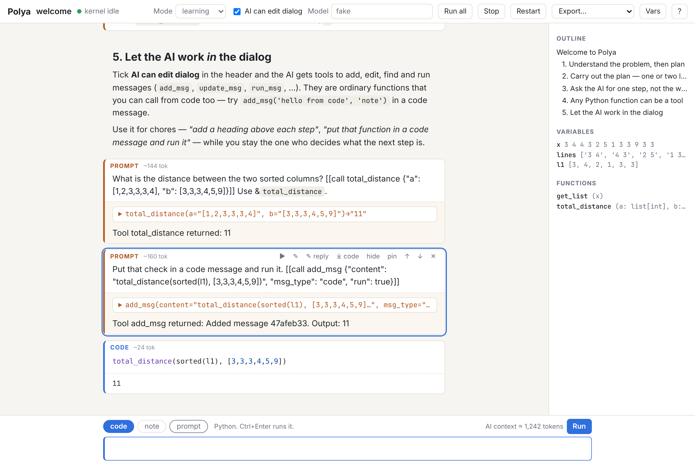

# Polya

A small, self-hosted **dialog notebook** for working the "solve it" way: code, notes and AI
prompts in one editable document, with a live Python kernel and an AI that sees exactly what
you see. It runs on your machine and talks only to the LLM endpoint you configure.

It is built almost entirely from [Answer.AI](https://github.com/AnswerDotAI)'s open-source
libraries — the same building blocks their Solveit product uses — and is named after George
Pólya, whose 1945 book *How to Solve It* the method comes from. It is not Solveit and is not
affiliated with Answer.AI.



*Screenshot taken against the scripted test endpoint in `tests/fake_llm.py` (the `[[call …]]`
text is that script's trigger, not something you type with a real model).*

## The method, in one minute

Asking an AI for 300 lines of code gets you code you don't understand and can't fix. The
alternative, from Answer.AI's write-ups of the Solveit method:

1. **Understand the problem** and **write down a plan** (a note).
2. **Carry it out one or two lines at a time**, running each step and looking at the output.
3. **Ask the AI for the next small step** when stuck, not for the whole solution.
4. **Look back**: tidy up, combine the pieces into a function only once each has been seen working.

The tool is shaped to make that the easy path:

| Design choice | Why |
|---|---|
| Three message types in one document: **code**, **note**, **prompt** | One conversation between you, the computer and the AI. The AI's context is the dialog itself. |
| The editor defaults to **code**, and returns to code after each prompt | You write the code; the AI helps. |
| AI code arrives in fenced blocks and is **never run automatically**; `w` copies the blocks into code messages | You read it before you run it. |
| Every message is editable, **including the AI's replies**; `h` hides a message from the AI, `p` pins it | "Dialog engineering": remove dead ends instead of arguing with the model, so sessions get better over time rather than worse. |
| Two modes: **basic** and **grill** | Basic answers one small step at a time. Grill interviews *you* about a plan, or about what some code does, before anything is written. |
| **Ctrl+click** any name to see its definition | You can't run a cell you don't understand; this shows the source of what you imported and lets you pull it into a cell. |
| Cells written by an AI are **marked** until you edit them | You can always tell what you wrote from what was written for you. |
| Any Python function is a **tool**: mention it as ``&`name` ``; ``$`expr` `` shows the AI a value | Same tools for human and AI. You decide exactly what the AI can do. |
| Optional **dialog tools** (`add_msg`, `update_msg`, `run_msg`, …) | The AI can add, edit and run cells in the notebook when you allow it. |

## Install and run

Linux, macOS or WSL, Python 3.11+.

```bash
pip install .            # from this folder; or: pip install -e . to hack on it

export POLYA_BASE_URL=https://your-llm-gateway.example.com/v1   # LiteLLM proxy, agent gateway, …
export POLYA_API_KEY=...                                        # read from the environment only
export POLYA_MODEL=your-model-name

polya --dir ~/dialogs    # then open http://127.0.0.1:5001
```

A `welcome` dialog is created on first run; it is a five-minute tour of the method.

## Working on an existing codebase

You do not convert the project. The repository stays the source of truth; a dialog is the
workbench beside it where you take code apart, try a change in small steps, and review what a
coding agent wrote before you accept it.

```bash
# install polya into the project's own virtualenv, then:
polya --dir ~/dialogs/myproject --project ~/code/myproject
```

- **`--project`** starts every kernel in that folder with it on the import path, so
  `from mypkg.orders import total` works as it does in the project.
- **Go to definition.** Hold `Ctrl` (`Cmd` on a Mac) and click a name in any code message, or
  press `F12` in an editor. A panel shows its signature, file, line and source, read from the
  live kernel, so it is the code that is actually loaded. `Ctrl`+click inside that source
  follows names within their own module. *Insert as code* copies the definition into a cell
  to run and change line by line (it redefines the name in the kernel only; the file is
  untouched). *Insert as note* puts it where the AI can see it. The name has to exist in the
  kernel first: run the import.
- **Project setup.** *Create project setup* on the dialog list makes a dialog called `SETUP`.
  Its **code messages run every time a kernel starts or restarts** (autoreload, environment
  variables, stand-ins for databases and services you can't reach). Its **notes are given to
  the AI in every dialog** as a standing brief. A failing setup cell is reported in a banner
  and the rest still run.
- `source_of("mypkg.orders.total")` returns the same source as text. It is preloaded, so you
  can call it, or hand it to the AI as a tool with `&`.

### Grill mode

Grill mode loads Matt Pocock's [`grilling`](https://github.com/mattpocock/skills) skill (MIT,
vendored unchanged in `polya/skills/`): the AI maps the open decisions, asks every question
it can ask now in one numbered round with a recommended answer for each, waits, and repeats
until nothing is left assumed. Use it on a plan before you or an agent write code, or on a
diff you are about to accept.

To add more of his skills, put their `SKILL.md` files under `<dialogs>/skills/`; they are
appended in grill mode. Most of them (`tdd`, `code-review`, `implement`, …) are written for a
coding agent with repository access and sub-agents, so they belong in that agent rather than
here.

## Connecting your coding agent

A coding agent that works in your repository (Claude Code, Codex, …) should see what you see
and leave its work where you can read it. Polya serves an MCP endpoint at `/mcp` for that.
The start-up message prints the command; for Claude Code:

```bash
claude mcp add --transport http polya http://127.0.0.1:5001/mcp \
  -H "Authorization: Bearer $(cat ~/dialogs/myproject/.polya-agent-token)"
```

What the agent gets:

| Tool | What it does |
|---|---|
| `list_dialogs`, `view_dlg`, `read_msg`, `find_msgs` | Read your dialogs: your notes, code, outputs and AI replies |
| `kernel_state`, `source_of` | See what is actually defined and loaded in the dialog's kernel |
| `add_msg` (with `run`), `run_msg` | Add notes and code cells **to your dialog** and run them **in your kernel** |
| `update_msg`, `del_msg` | Change or remove **only cells it added itself** |

The rules it works under:

- Everything it adds is marked **added by agent** until you edit it.
- It cannot edit or delete a message you wrote; the server refuses.
- It cannot add prompts, so it cannot drive the notebook's AI.
- The server sends it working instructions on connect: read the dialog first, run experiments
  as cells rather than in its own shell, keep cells small, say which files it changed.

Those instructions are a request, not a control. The agent still has its own shell and may
use it. To make the dialog the place it works, repeat the instruction in your `CLAUDE.md` or
`AGENTS.md` (*"run all experiments through the polya MCP tools so I can see them"*) and
refuse work whose evidence is not in the dialog.

### Pointing it at your LLM endpoint

| Setting | Meaning |
|---|---|
| `POLYA_BASE_URL` | Base URL of the endpoint. With this set, requests go there and nowhere else. |
| `POLYA_API_KEY` | Key for that endpoint. Environment only, never on the command line or in a dialog file. |
| `POLYA_MODEL` | Default model name. Each dialog can override it in the header. |
| `POLYA_API` | Wire format: `openai_chat` (default with a base URL; what LiteLLM proxies and most gateways speak), `openai` (Responses API), `anthropic`, or `gemini`. |
| `POLYA_CTX_TOKENS` | Context window to fit the dialog into (default 200000). Oldest unpinned messages drop out first. |
| `POLYA_MAX_TOKENS`, `POLYA_MAX_STEPS` | Reply length (4096) and maximum tool rounds per prompt (12). |
| `POLYA_KERNEL` | Jupyter kernelspec for code (default `py` = ipymini; `python3` = ipykernel if you have it). |

Without `POLYA_BASE_URL`, the model name decides the provider (e.g. a `claude-…` model uses
the Anthropic API with `ANTHROPIC_API_KEY`).

## Using it

Click a message to select it; `?` lists every shortcut.

- **Bottom editor**: pick `code`, `note` or `prompt`, type, `Ctrl+Enter`.
- **Selected message**: `Enter` edit · `Ctrl+Enter` run / send · `n` edit the AI's reply · `w` extract code blocks ·
  `h` hide from AI · `p` pin · `x` `c` `v` cut/copy/paste · `a` `b` add above/below · `Alt+↑/↓` move.
- **Any code**: `Ctrl`+click a name for its definition.
- **Header**: mode (basic / grill), *AI can edit dialog*, per-dialog model, Run all, Stop, Restart, Export (`.ipynb`, `.md`, `.py`), Vars (outline + live variables).

### Tools

```python
def total_distance(a: list[int], b: list[int]) -> int:
    "Sum of absolute differences between paired items of `a` and `b`"
    return sum(abs(p - q) for p, q in zip(a, b))
```

Then in a prompt: ``Use &`total_distance` on the two columns of $`x`.`` The function needs type
hints and a docstring; it runs in your kernel when the AI calls it, and the call and its result
are saved in the reply.

The dialog tools are preloaded in every kernel, so you can use them from code as well:
`add_msg`, `update_msg`, `del_msg`, `read_msg`, `find_msgs`, `view_dlg`, `msg_str_replace`,
`run_msg`. Tick **AI can edit dialog** to give all of them to the AI, or mention individual
ones with `&`.

## What it is built from

| Piece | Library | Role |
|---|---|---|
| Web app | [FastHTML](https://github.com/AnswerDotAI/fasthtml) | Server, routing, pages; live updates over server-sent events |
| Dialog model + storage | [aidialog](https://github.com/AnswerDotAI/aidialog) | Messages, edits, search; dialogs are ordinary `.ipynb` files in the format aidialog defines for Solveit dialogs |
| Model input | [aihist](https://github.com/AnswerDotAI/aihist) | Turns the dialog above a prompt into model input (hidden/pinned, context fitting, `$`/`&` references) and defines the saved reply format with tool calls |
| Model calls | [fastllm](https://github.com/AnswerDotAI/fastllm) (`python-fastllm`) | Streaming completions and tool calling against your endpoint |
| Kernel | [ipymini](https://github.com/AnswerDotAI/ipymini) + [conkernelclient](https://github.com/AnswerDotAI/conkernelclient) + ipyfuncs | One Jupyter-protocol kernel per dialog: streamed output, interrupt, completion, tool schemas |
| Rendering | [mdhtml](https://github.com/AnswerDotAI/mdhtml), [fastpylight](https://github.com/AnswerDotAI/fastpylight) | Markdown (raw `<script>`/`<style>` render as text) and syntax highlighting |
| Tool schemas, CLI | [fastcore](https://github.com/AnswerDotAI/fastcore) | `funccall` and `script` |
| Agent bridge | [mcpmini](https://github.com/AnswerDotAI/mcpmini) | MCP over HTTP at `/mcp` |
| Grill mode | [mattpocock/skills](https://github.com/mattpocock/skills) `grilling` (MIT) | Vendored skill text |
| Editor | CodeMirror 5 (MIT), vendored in `polya/static/vendor` | No CDN is contacted at runtime |

Deliberately **not** used: `rustygate`, Answer.AI's kernel gateway. Its licence is proprietary
rather than open source, and its built-in AI turn sends requests to `solve.it.com`.
`lisette` was also dropped: its current release does not import against current `toolslm`.

## Security notes — read before sharing with a team

- **It runs arbitrary code.** That is its job. It listens on `127.0.0.1` only by default and has
  no login. Do not pass `--host 0.0.0.0` on a shared network: anyone who can reach the port can
  run code as you.
- **Outbound traffic.** The server contacts only the configured LLM endpoint. The page loads no
  external assets. Code you run in the kernel can of course reach whatever your machine can.
  (`fastllm` has code to download a model price list from GitHub if its bundled copy is missing;
  the copy ships in the wheel, so this does not happen on a normal install.)
- **What is sent to the model:** the non-hidden messages above the prompt (code, outputs as
  text, notes, earlier prompts and replies), values of `$` expressions, and the schemas of tools
  you named. Images and plots are not sent.
- **Cross-site protection:** state-changing requests must come from the app's own pages; the
  kernel-to-server tool API needs a per-run random token.
- **The agent endpoint** needs the bearer token in `<dialogs>/.polya-agent-token` (created
  with owner-only permissions, kept between runs). Anyone holding it can run code in your
  kernels, which is what the agent needs it for. Delete the file to rotate it.
- **Maturity of dependencies.** Several of the Answer.AI packages are young (0.0.x–0.1.x), some
  are Rust extensions, and ipymini's own README says it was largely AI-written. Pin versions and
  have them reviewed the way you would any dependency. `POLYA_KERNEL=python3` swaps in ipykernel
  (`pip install ipykernel`); the kernel layer is checked against it, the browser suite is not.

## Not implemented (Solveit has these)

Ghost-text and "super" completions, image input to the model, web search and URL-reading tools,
collapsible sections, real-time multi-user editing (several browsers on one dialog do stay in
sync, but there is no auth), publishing, a terminal, git checkpoints, module export.

## Tests

```bash
pip install matplotlib pandas     # used by one test
bash tests/run_e2e.sh             # needs node + playwright + chromium
```

This starts `tests/fake_llm.py` (a scripted OpenAI-compatible endpoint — not a model) and
drives a real browser through: run-all, streaming replies, code-block extraction, kernel tools,
`$` variables, AI-added-and-run cells, tools called from code, hide/pin/edit-reply, interrupt,
restart, plots, completion, reordering, cut/paste and persistence. Against the sample
project in `tests/sample_project` it also covers go-to-definition, the `SETUP` dialog,
autoreload, both modes, and the agent endpoint through an MCP client (`tests/agent_bridge.py`).

**Not tested against a real model or a real coding agent**: no credentials were available
where this was built. The OpenAI-compatible wire format and the MCP endpoint are exercised end
to end (the latter with mcpmini's own client, not Claude Code); how well a model follows the
grilling skill, and whether an agent keeps to the dialog, are not.
